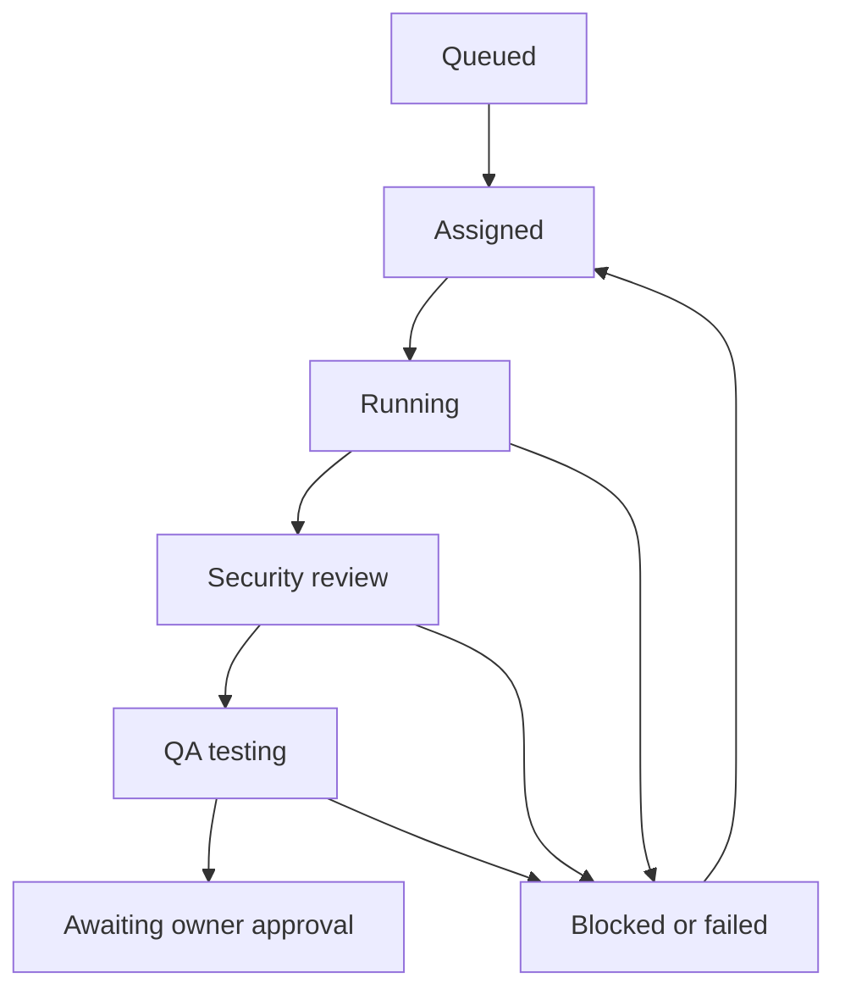

# AmericanSites Agent HQ — vertical slice

A React / React Three Fiber headquarters connected to a real Node 24 + SQLite task/event service. The first recorded task was performed by actual collaborating session agents: BoB assigned a keyboard-navigation improvement, Codex edited the historical website, Security reviewed its exact SHA-256, and QA ran the acceptance tests. The task stops at `awaiting_approval`.

**This is a local development vertical slice, not an unattended agent service or production deployment.** HTTP is read-only. Trusted local worker commands record actual actions; neither the scene nor timers invent work. The model calls for this build happened in the authoring session, not inside the application. No model API key, paid runner, outreach, production deploy, or destructive adapter is connected.

## Source and deployment inspection

- Repository: https://github.com/FeikL2002/AmericanSites.us
- Base: `master` at `b85d0f1c2bfd60959f5328de3122ee6af24b870c`.
- Isolated branch: `feat/agent-hq-vertical-slice`.
- The repository describes itself as historical source snapshots; `AmericanSites  "Live"` is a historical directory name. The live `https://americansites.us/` has newer content. The GitHub source has not been verified as that deployment's current source.
- Neither connected Netlify account returned a matching AmericanSites project. No unrelated project was changed.
- Root archives and the historical `.venv` are excluded from this app's build. Existing malformed historical CSS/JS files are untouched.

## Run locally

Requires Node **24+** (`node:sqlite`), npm, and a WebGL2-capable browser.

```sh
cd agent-hq
npm ci
npm test
npm run dev
```

Open the URL printed by Vite (normally `http://127.0.0.1:5173/`). The authoring workspace's managed preview used `http://127.0.0.1:4173/`; that address belongs to the workspace, not a public Netlify deployment. `npm run start` runs the read-only API alone. `npm run build` compiles the frontend, but a static deployment alone does not run the backend.

The server stores SQLite in `data/hq.sqlite` by default. Restarting the process preserves the database. Set `HQ_DB_PATH` to a private persistent volume when operating on a long-lived host. Runtime databases, credentials, and dependencies are ignored by Git. The real first-run evidence is preserved in `evidence/verified-run.json`; a fresh checkout starts with an empty live database rather than pretending that the historical run just happened.

## What the interface supports

- Three-floor procedural 3D glass office with five role workstations, clickable desks, multiple rooms, lit stairs, reception, plants, signage, orbit controls and room focus.
- A procedural **Lamborghini-inspired** wedge sports car. This is not a licensed/high-fidelity Lamborghini asset. The scene is an initial implementation, not a photorealistic match to the supplied reference.
- Worker typing/head animation only when the backend supplies an active task with an unexpired lease. Idle, blocked, disconnected and approval states do not work-animate. Reduced-motion controls stop worker movement.
- Task inspector, structured evidence, activity ledger, cost/limit controls, exact task selection, keyboard-accessible role buttons, and structured request preparation.
- Explicit historical replay reconstructs ownership from events and uses recorded timestamps. Missing historical heartbeats remain unknown/inactive, never fabricated. Future heartbeats are logged.
- A clearly labeled **design reference — not live data** fallback on browsers without WebGL. Numbers baked into the supplied image are not operational metrics.

The cloud QA browser reports `GL_VENDOR = Disabled` and cannot create a WebGL context. The fallback and surrounding controls were inspected; the actual scene still requires a visual/performance check on a WebGL-capable device. JSX/build checks do not prove rendering fidelity.

## Real task protocol

The browser's Prepare task button only prepares a JSON request; it does not claim to queue or start an agent. Submit requests through the trusted local CLI:

```sh
npm run hq -- command request.json
npm run hq -- state
```

Each command carries `action`, `actor`, a stable `idempotencyKey`, and (after creation) `taskId` and the latest `revision`. See `server/README.md` for exact commands and evidence fields. Role attribution through this local CLI assumes the host operator is trusted; it is not multi-user authentication.



Review requires a recorded implementation hash. Testing requires the latest passing security review for that hash. Owner review requires the latest passing QA result for that same hash. A newer failure overrides an older pass. The approval state has no automatic deployment continuation.

Limits: 32 task steps, two execution attempts, one-hour task runtime, two-minute worker lease, 100 tasks, one simultaneous work lease per role. These bound the task protocol; there is no autonomous model loop in this slice. Paid execution is disabled with a zero-dollar budget. Provider-receipt accounting supports exact input/output/cached tokens, prices and request IDs; the authoring session's tokens and dollars are unavailable (`null`), not reported as zero.

## Verification and evidence

- `tests/backend.test.mjs`: 18 tests — state transitions, role checks, revisions, idempotency, evidence hashes, later-failure precedence, limits, leases, SQLite reopen persistence, usage receipts and HTTP boundaries.
- `tests/worker-state.test.mjs`: 10 tests — historical ownership, handoff behavior, lease expiry, budget limits, and no future/live state leakage.
- `tests/website.test.mjs`: 3 tests — the actual historical homepage keyboard improvement.
- QA baseline: 0/3 passed. After implementation: 3/3 passed. Full suite: **31/31 passed**. Vite build passed.
- Browser: first Tab focuses “Skip to main content” at y=12 with a visible 3px outline; Enter focuses `MAIN#top`. This used the actual file through a development-only route with scripts removed and CSP blocking external resources and form submission. No Formspree/Stripe operation was tested or triggered.
- Independent security probes on an isolated Vite instance using the final configuration: database/WAL files, outside-root path, and foreign Host return 403. The managed preview ports are isolated from ordinary executor HTTP probes, so these checks do not claim access to that process.
- See `evidence/website-baseline.json`, `website-implementation.json`, `website-qa.json`, `final-verification.json`, `qa-review.md`, `security-review.md`, and `verified-run.json`.

## Remaining blockers before production

1. Identify and authorize the current AmericanSites Netlify project/deployment source. Do not merge the historical snapshot as a replacement for the live website.
2. Visually/performance-test the procedural scene on a WebGL2-capable browser, including mobile. Improve models/materials to match the reference's realism.
3. Choose a persistent host/backend. SQLite requires durable private disk and cannot be placed on ephemeral Netlify Functions storage. A Netlify frontend would need that authenticated backend, or a separately reviewed persistent database adapter.
4. Add authenticated remote actor identities and an actual bounded Codex/model execution adapter after credential and spending approval. A task record alone is not proof that a worker executed it; the trusted operator must attach actual evidence.
5. Add artifact-bound owner authorization and deployment adapters only after explicit owner approval. Public hosting, outreach, purchases and destructive operations stay disabled.

No production deployment, external outreach, paid API request, or destructive action was performed.
